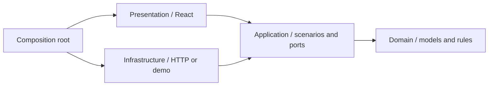

# Архитектура клиента

Зависимости направлены к моделям и сценариям, а не к библиотекам и транспорту:

- `domain`: `Product`, `User`, `Order`, `CartLine`, ограничения корзины и стоимость доставки. Без React, сети и браузерного хранилища.
- `application`: интерфейсы `ShopGateway` и `Preferences`, фильтрация каталога, перенос гостевого избранного. Зависит только от domain.
- `infrastructure`: `HttpShopGateway` знает HTTP-контракт `/api/store`; `DemoShopGateway` моделирует эти же операции локально. `BrowserPreferences` изолирует формат и ошибки localStorage.
- `presentation`: страницы и компоненты, отображение локализованных данных, формы, состояние React и анимации. Получает адаптеры через `StoreProvider`, зависит от их интерфейсов.
- `app` и `index.tsx`: соединяют слои, выбирают режим и маршрутизацию. Конкретные адаптеры не создаются внутри страниц.

`npm run check:architecture` анализирует импорты TypeScript, включая динамические, и запрещает зависимости внутренних слоёв от внешних. Проверка также запрещает доступ к runtime API внутри domain/application. Интеграционные тесты могут создавать конкретные адаптеры.

## Режимы

| | API | Демо |
|---|---|---|
| Gateway | HttpShopGateway | DemoShopGateway |
| Маршруты | BrowserRouter | HashRouter |
| Авторизация | Серверная HttpOnly cookie | Готовый учебный профиль |
| Данные | Сервер | Память + localStorage |
| Заказы | API, транзакции и остатки | Локальная симуляция |
| Ключи браузера | `step-*` | `step-demo-*` |

Демо выбирается при сборке, а не параметром пользовательского URL. В production-демо удаляется неиспользуемый HTTP-адаптер. Симуляция проверяет остатки, отмену и статусы, но не является системой авторизации. Полномочия в режиме API всегда проверяет бэкенд.

Модели двух репозиториев согласованы через HTTP-контракт. Репозитории не импортируют исходники друг друга и не требуют третьего общего пакета. Демокаталог — версионированный снимок вымышленных товаров, а не копия рабочей базы.

## Добавление сценария

1. Добавьте входную модель и метод в application port.
2. Реализуйте HTTP- и демо-адаптеры.
3. Используйте метод через `useStore().shop` в UI.
4. Проверьте бизнес-правила отдельно и поведение адаптеров — контрактными тестами.

Не размещайте fetch, URL API или чтение localStorage в компонентах. Физика карусели и появление блоков относятся к presentation, а не к domain. CSS остаётся в этом слое; порядок подключений централизован в `presentation/styles/index.css`.
